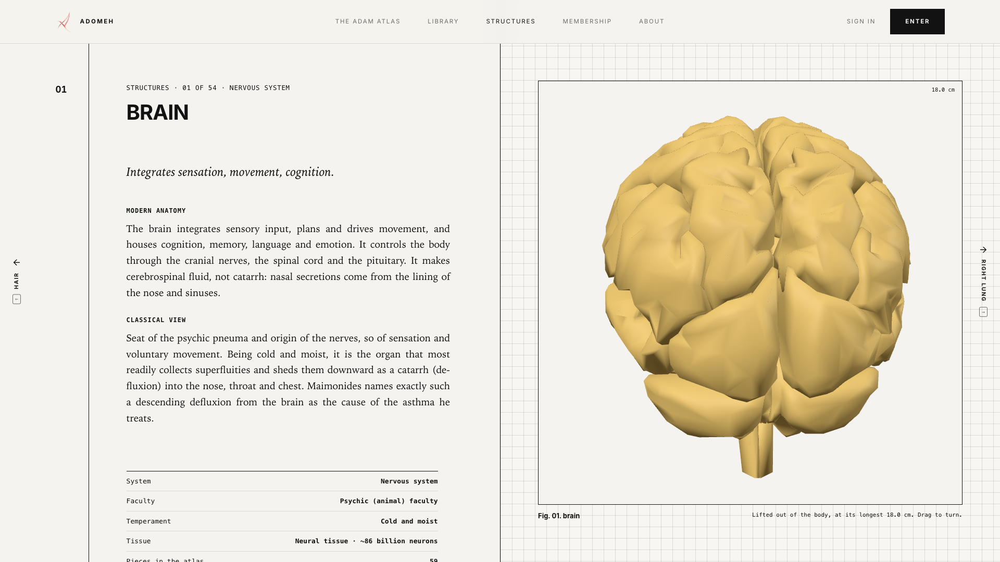
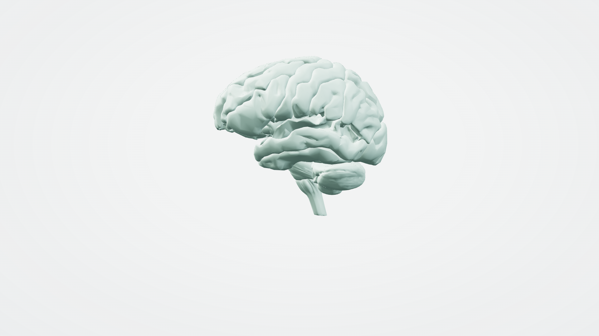
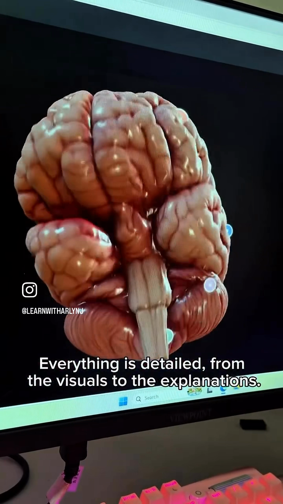
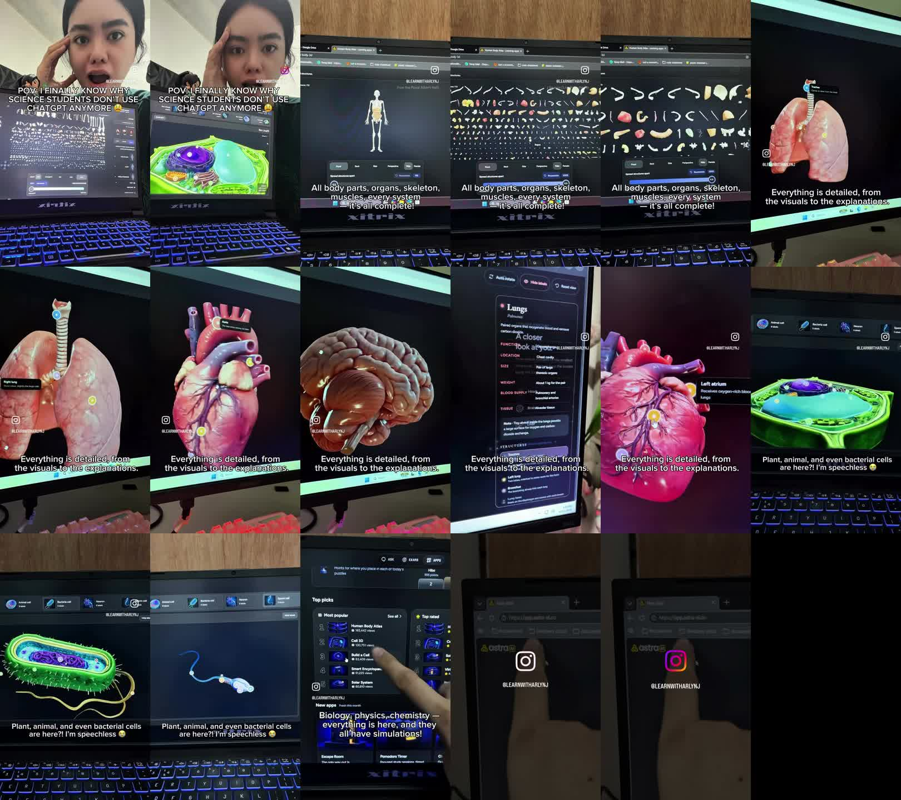
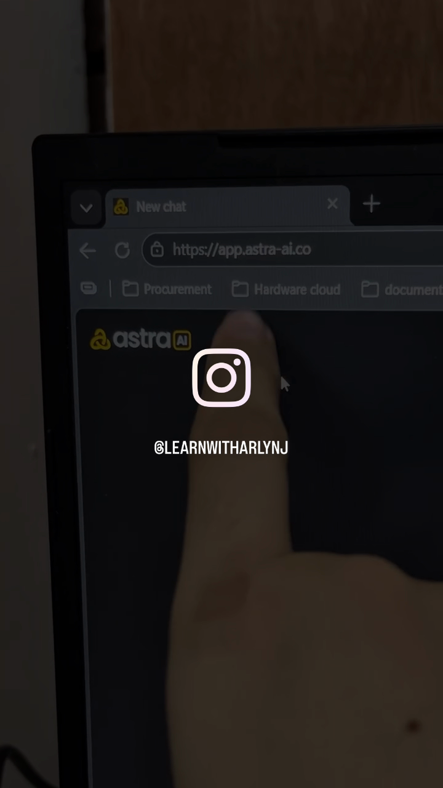

Adomeh / Adam · Technical & visual review · 14 October 2026

# The atlas is current. The close-ups need better assets.

Adam is not missing an upstream update. Astra AI’s polished organ views use a separate specimen pipeline layered onto the same Human Atlas foundation. We can pursue that approach in Adam without replacing the whole application.

Scope: local Adam checkout, freshly fetched GitHub branches, upstream proposals, the supplied 34.6-second video, and Astra AI’s publicly delivered application code. Research only; no application features changed.

**0** — upstream commits missing from Adam

**15,998** — triangles in Adam’s standalone brain specimen

**2 paths** — Astra’s body atlas + separate organ GLBs

## 1. Repository status

I fetched both remotes and compared ancestry, rather than relying on repository update dates. Upstream [main is still at `1c38bf3`](https://github.com/ashemag/human-atlas/commit/1c38bf35c254a891200d3cedecfd57abebe83d8d), “Restore Human Atlas title,” dated September 6, 2026. That commit is an ancestor of every Adam branch listed below.

| Adam reference | Commit | Ahead of upstream | Behind upstream |
| --- | --- | --- | --- |
| Checked-out `humours-figure` | `4bc54e6` | 60 | 0 |
| Local `main` | `42a68f9` | 59 | 0 |
| Freshly fetched `origin/main` | `da1b422` | 63 | 0 |

**There is no newer merged atlas or renderer to pull from upstream main.** Its earlier September 5 mobile-layout and inspection improvements are already in Adam’s ancestry. The GitHub releases endpoint returned no releases. This comparison does not establish which commit is deployed to production.

Adam’s `atlas.json` is byte-identical to upstream. Git reports no changes to the core `body-*.bin` / gzip geometry files. Both retain 2,234 meshes, 3,432 concepts, 15 chunks, and 2,288,268 compiled triangles from BodyParts3D 4.0. Adam has added its own specimen files, reader, library, study interactions and other product features.

The five files most relevant to this analysis—atlas manifest, scene renderer, specimen renderer, specimen index, and specimen build script—also match freshly fetched `origin/main`. The rendering findings are therefore not peculiar to the checked-out feature branch.

### Community work exists, but it is not a released update

The live GitHub API returned 30 open pull requests. These are candidates for review, not validated upgrades:

| Proposal | Potential value to Adam | Assessment |
| --- | --- | --- |
| [#4 · Load anatomy per system](https://github.com/ashemag/human-atlas/pull/4) | Fetch only the systems being viewed; useful for mobile and focused lessons. | Worth reviewing. Its author reports download savings; I did not reproduce the benchmarks. |
| [#429 · Lung search and synonyms](https://github.com/ashemag/human-atlas/pull/429) | Better discovery of pulmonary and bronchial structures. | A relatively narrow improvement worth assessing against Adam’s search behavior. |
| [#283 · Peripheral nerves](https://github.com/ashemag/human-atlas/pull/283) | 54 named nerve meshes from Z-Anatomy. | Coverage improvement. Review anatomical registration and the stated CC BY-SA asset terms. |
| [#434 · Female anatomy](https://github.com/ashemag/human-atlas/pull/434) | Broader reference anatomy. | Separate content project; not the solution to the brain’s surface appearance. |
| [#236 · Phase 4 fidelity](https://github.com/ashemag/human-atlas/pull/236) | Additional anatomical layers and a substantially modified viewer. | A broad fork proposal, not a small photorealism patch. Avoid importing it wholesale. |

Adam already has cursor-centered zoom, individual hiding state, focus transitions and study behavior that overlap some proposals. Review individual changes before deciding what is actually missing.

## 2. What the Instagram video actually shows

The closing address bar identifies **Astra AI at `app.astra-ai.co`**. The relevant product is its [Lab / Learning apps](https://app.astra-ai.co/lab), specifically [Human Body Atlas](https://app.astra-ai.co/en-US/lab/human-body-3d) and Cell 3D. The video does not demonstrate an OpenAI “Lab” rendering API. Ai2’s similarly named Asta is also a different product.

I used HyperFrames transcription and website capture, plus FFmpeg/ffprobe frame extraction and media inspection. The file is 720 × 1280, 30 fps, 34.6 seconds. The transcription returned music lyrics rather than a technical explanation; the evidence for the claims comes from the on-screen captions, images, address bar and application code.

| Approximate time | Visible content | What it establishes |
| --- | --- | --- |
| 0–4 s | Intro, atlas overview and cell teaser | Promotional framing, not a technical comparison. |
| 4–10 s | Body and exploded array of anatomical pieces | A broad anatomy explorer. |
| 10–22 s | Lungs, heart, brain, labels and explanatory panel | Dedicated close-ups with more organic surfaces. Brain evidence frame: 17.5 s. |
| 22–28 s | Plant, bacterial and other cell views | A separate cell visualization offering. |
| 28–34.6 s | App catalog and Astra address/logo | Product identification; address evidence frame: 31 s. |

The footage is a camera recording of a display: perspective, monitor color, reflections and compression affect the apparent gloss and contrast. It is sufficient to identify a visual gap, not to measure rendering speed or prove anatomical accuracy.

## 3. Yes—the brain looks substantially different



Adam’s Structures page: actual local capture. Coarse facets and uniform system color are plainly visible.



Adam’s full atlas: more geometry and smoother folds. Mint color is the selection highlight, not tissue color. UI hidden with the app’s existing capture route.



Astra in the supplied video, 17.5 s: rounded folds, varied tissue appearance, fine cerebellar detail and pronounced highlights. These views are not angle-matched.

Astra’s example reads as a shaded, textured anatomical illustration; Adam reads as a system-colored reference mesh. The difference involves silhouette, folds, local surface detail, color variation, shading and presentation. A darker background alone cannot close it. Nor does a more convincing image, by itself, establish a more accurate anatomical model.

### The decisive architectural finding

Astra’s public JavaScript credits ashemag’s Human Atlas and references a male-atlas directory ending in `1c38bf35c254`—the same upstream revision Adam contains. Its organ viewer separately fetches GLB files, including `brain.1547838afd2f.glb`, and loads them with Three.js `GLTFLoader`. It defines ten specimen choices with nine distinct GLB URLs; small and large intestine share one asset. The brain has five manually positioned label hotspots.

**The close-up brain is a different asset pipeline, not evidence of a newer upstream brain mesh.** The public viewer code uses conventional Three.js lighting and material adjustments. There is no need to assume a proprietary real-time AI renderer to explain the result. See the [public bundle inspected](https://app.astra-ai.co/_next/static/immutable/chunks/3m_u64eops2ad.js) and its [saved research copy](evidence/astra-public-bundle.js).

Asset and attribution requests to Astra’s CDN returned HTTP 403. I could not inspect the GLB metadata, texture inventory, polygon count, original creator or asset-specific license. I also cannot establish whether those models were scanned, manually authored, generated, or licensed. The anatomy-base attribution does not establish reuse permission for these separate specimens.

## 4. What limits Adam today

| Property | Full atlas | Standalone brain specimen |
| --- | --- | --- |
| Brain geometry | 59 constituent parts; 141,458 triangles | Merged into one geometry; 15,998 triangles, 8,081 vertices |
| Material | System-colored MeshStandardMaterial; roughness .53, metalness .08 | Vertex system colors; roughness .58, metalness 0 |
| Surface textures | No tissue color, normal or roughness textures in this path | No UV attribute or tissue texture maps |
| Lighting and output | Room environment / PMREM; hemisphere and directional lights; explicit ACES tone mapping | Two camera-mounted directional lights plus hemisphere; no environment map or explicit tone mapping |
| Optimization | Atlas simplifier configured for .002 relative error | Specimen simplifier configured for .05 error; brain lands at about 16k triangles |

The brain specimen keeps about **11.3% of its compiled-atlas triangle count**: an 88.7% reduction. Its 192,964-byte file is economical for a thumbnail, but the same asset is enlarged on the detail page. That is the clearest first target. These are actual file/index counts; the simplification error setting is not a measured anatomical-error percentage.

Both paths already use physically based materials. The missing work is better input geometry and material data, plus a consistent lighting setup. [Three.js’s material documentation](https://threejs.org/docs/pages/MeshStandardMaterial.html) describes color, normal, roughness and occlusion maps and recommends environment lighting. Normal maps improve perceived fine detail but do not repair a coarse silhouette.

Relevant implementation locations: [app/specimen.ts](../../app/specimen.ts) (load and render), [app/specimens.ts](../../app/specimens.ts) (generated counts), [scripts/build-specimens.mjs](../../scripts/build-specimens.mjs) (simplification), [app/scene.tsx](../../app/scene.tsx) (atlas renderer), and [app/structures.tsx](../../app/structures.tsx) (thumbnail and detail use the same specimen).

## 5. Recommended upgrade

**Start with one high-quality brain specimen.** Keep the body atlas for anatomical selection and relationships, and introduce a richer close-up representation linked to the same concept. Once its quality and performance are proven, extend the approach to heart and lungs.

1. **Separate thumbnail and detail geometry.** Keep the existing compact tiles. On opening a specimen, load a higher-detail version. First compare the current 16k brain against its existing 141k atlas source under identical lighting. This isolates the cost of our extra simplification without buying a model or changing the full atlas.

2. **Make the specimen renderer consistent.** Add deliberate tone mapping and environment lighting; use organ-appropriate nonmetallic materials, restrained highlights and a readable backdrop. Compare the same camera angles before and after. This should improve form, but will not manufacture missing tissue detail.

3. **Add a properly sourced textured GLB.** Preserve its materials and UVs instead of flattening it into the current colored binary format. Prefer a mesh with reliable anatomical provenance, then add or retain color, normal and roughness detail. Use a separate manifest for author, source URL, license, concept mappings and asset version. Do not infer medical reliability from appearance.

4. **Connect the rich specimen to Adam’s teaching.** Keep the original FMA concepts and reader links. Provide an explicit return to the segmented atlas. A beautiful single-shell brain does not automatically support dissection or selection of the original 59 parts; detailed selection requires a segmented asset or separately mapped geometry.

5. **Measure, then scale.** Lazy-load detail assets, compress geometry and textures, cap device pixel ratio and retain a fallback. Test orbiting and loading on an actual phone. Proposed acceptance targets—not current measurements—are at least 30 fps on the chosen baseline phone and a single-digit-megabyte brain download where feasible.

The proof should compare four conditions: current specimen; higher-detail existing mesh; that mesh with improved lighting/material treatment; and a vetted textured model. Capture front, side, underside and a full rotation. Review anatomy, labels, silhouette, mobile frame time and loading together. This establishes which changes earn their cost.

### Asset candidates to investigate

The [HRA male brain v1.3](https://3d.nih.gov/entries/3DPX-020960?version=1) is a reference option with 141 anatomical structures and stated CC BY 4.0 licensing. Its description explains that the original hemisphere was mirrored; it is not automatically a photoreal surface replacement. The [UCSF sulci-and-gyri model](https://sketchfab.com/3d-models/cps-model-1-sulci-gyri-of-left-hemisphere-216d50de44084049800ac0d548fb51b5) is another candidate, with a listed 1.1 million triangles and CC Attribution licensing; it would need web optimization and is a left-hemisphere model. These are research leads, not approved production assets or confirmed matches to Astra.

If neither meets the intended visual standard, commission or license a medical-illustration-quality brain, with explicit permission for redistribution inside a browser app. Any AI assistance should accelerate modeling and texturing around a reviewed reference, with the anatomical structure checked independently.

## 6. Where HyperFrames helps

HyperFrames was useful here for capturing Adam’s actual WebGL output and checking the video’s audio. It can also produce repeatable comparison captures, turntables, annotations and a polished demonstration of the upgraded result. The interactive app’s realism remains a Three.js, geometry and material task; encoding a video at higher resolution cannot recover missing anatomy or textures.

## Evidence, reproducibility and limitations

Both HyperFrames captures returned `ok: true`, HTTP 200 and no warnings; I visually inspected the resulting images. See [specimen capture metadata](evidence/specimen-capture.json) and [atlas capture metadata](evidence/atlas-capture.json). Screenshots show the local checked-out source, not a verified production deployment.

```text
git fetch upstream
git fetch origin
git rev-list --left-right --count HEAD...upstream/main       # 60 0
git rev-list --left-right --count main...upstream/main       # 59 0
git rev-list --left-right --count origin/main...upstream/main # 63 0
git merge-base HEAD upstream/main                          # 1c38bf35c254a891200d3cedecfd57abebe83d8d
git diff upstream/main HEAD -- public/models/atlas.json 'public/models/body*'
# No differences in these compiled atlas files.
```

The video was sampled throughout at two-second intervals, with targeted full-resolution frames for the brain and product identity. The contact sheet is an overview; use the exact extracted frame for timing. No subjective realism score, competitor FPS, polygon count or clinical accuracy result is claimed. Open PR implementations were not installed or tested. No models were purchased, imported into Adam or deployed.

Original video: `/Users/ilprinceps/Downloads/d195f1a06d6e484f9e00588403e38704.MP4`. Temporary working files: `/tmp/adam-atlas-audit`. The report and selected evidence are saved here for review; the supplied video and pre-existing `docs/brand/` files were left intact.



Overview of the supplied video, sampled at two-second intervals.



Product identity at 31 seconds.

Assessment: a better-looking Adam is technically feasible with the current stack. The first deliverable should be a verified brain comparison, followed by a reusable detail-asset pipeline. Pulling upstream main will not deliver the improvement shown in this video.
